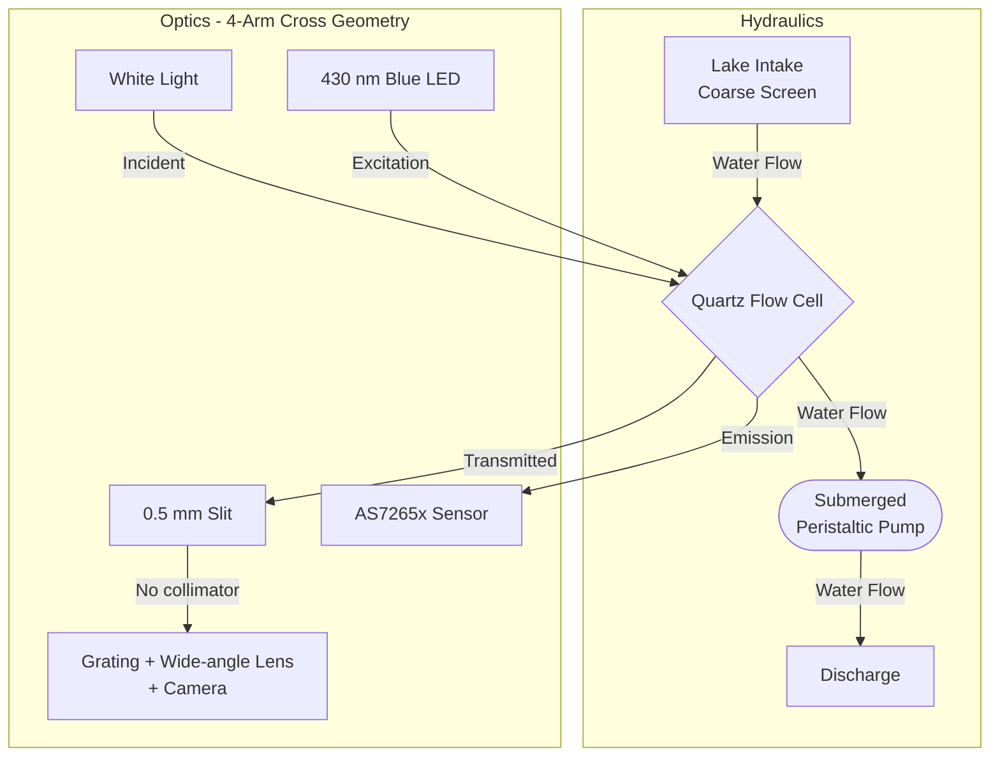

# Cruz Prototype

> **Autonomous Spectrophotometer and Fluorometer for Natural Water**

**Project navigation:** Start with the [engineering index](docs/INDICE_PROYECTO.md) for the latest available design, evidence, purchasing files, and earlier revisions. The status sections below describe the concept as of 30 October; the index points to subsequent work and its limitations.

Cruz integrates the previously separated MonoSpectro and fluorometer instruments into a single autonomous apparatus. By sharing a central sample chamber in a 4-arm cross geometry, it performs both transmission and fluorescence measurements in-situ.

## 🎯 Engineering Scope
This repository contains exclusively the **engineering, design, fabrication, firmware, and validation** of the Cruz prototype.
*The scientific paper and related publications fall outside the scope of this repository.*

## 📊 Current Status
- 🟢 **Functional specification approved**
- 🟢 **Optical layout agreed; physical integration still to be measured**
- 🟡 **Clear acrylic body with bolted end caps; horizontal deployment and ballast on side rods (30 Oct)**
- ⚪ **Validation pending**

## 🔬 System Architecture

Water travels through tubing and the quartz cell inside a sealed optical head; leak detection and a dry-immersion test are required before electronics are installed. The optics follow a 4-arm cross geometry, enabling collinear excitation and detection for fluorescence, and direct transmission measurement on the perpendicular axis.

The current enclosure uses a **clear acrylic tube deployed horizontally**, with a bolted acrylic front cap and a compressed silicone gasket. The auxiliary USB camera looks **forward through the end cap**. The previous acrylic dimensions, 150 mm OD / 140 mm ID / 5 mm wall and a 330 mm tube length, are retained as fit references pending the horizontal layout check. Side rods carry ballast; supports, loads, caps and seals still need design and testing. PVC has been dropped. See the [current mechanical concept](docs/IMPLANTACION_ACRILICO_HORIZONTAL.md).

The [Fruugo IMX179 auxiliary camera](https://www.fruugo.be/industriele-4k-usb-webcam-pc-laptops-video-8mp-autofocus-usb-camera-imx179-sensor-otg-uvc-plug-play/p-478082530-972533366?language=nl) remains additional to the OV9281 and AS7265x. Its dimensions and effective imaging modes still need verification. Local optical shielding remains necessary. The earlier vertical acrylic-tube and horizontal PVC sketches are archived concepts and do not represent this layout.

The MS11HS5L410C-01 pump remains downstream of the cell, with 3 × 5 mm pump tubing and the selected CITYORK battery. The [eight-contact service port](electronica/PUERTO_SERVICIO_Y_BOYA.md) reserves separate charging, external power and RS-485 functions, with no Wi-Fi. Alex confirmed the Switchcraft EN3 panel connector, cable mate and sealing cap with contacts included on 30 October (D51); this replaces the earlier Bulgin order with separate contacts. Panel fit, cable, pinout and circuits remain to be finalized. The interface anticipates a future solar-powered buoy with a compatible logger/transmitter. At Alex's request, the existing energy estimate is retained without recalculation for the additional camera. Temperature and conductivity remain planned using available parts; a depth sensor is excluded from this version.

The [current electronics proposal](electronica/DISENO_ELECTRICO_V1.md) reuses the available A4988 and three 5 A buck modules. The chosen white Optisolis LED replaces the halogen source; separate current regulators drive white and blue. A supervisor controls the acquisition supply and waits for Linux shutdown before cutting Pi power. Battery/charger voltage, motor phase current and thermal behaviour still require bench verification. The consolidated shopping workbook includes only proposed missing parts, with numeric VAT-inclusive prices.

The [earlier M1 mechanical design](cad/README.md), its three printed enclosures and exported drawings remain as concept history. They do not describe the current tube assembly and must not be fabricated as the current design. See the [shopping list](LISTA_COMPRA.md) and [current end-cap and ballast plan](docs/IMPLANTACION_ACRILICO_HORIZONTAL.md).

## 📐 Design Principles
- **Sensor Reusability:** Retain original detectors (monochrome camera for spectrophotometry, AS7265x for fluorescence); the white Optisolis LED replaces the former halogen source (D52).
- **Shared Geometry:** Use a single quartz flow cell to measure the same sampled volume for both modalities.
- **In-Situ Autonomy:** Designed to operate independently for days, handling water renewal and local data storage.
- **Fabrication:** Transparent acrylic body with dedicated end caps, printed internal supports and optical mounts. Watertightness remains to be demonstrated after adding all ports.

## ⚙️ Current Specifications
| Parameter | Target Objective |
| :--- | :--- |
| **Medium** | Initial freshwater trials; eventual application in bays |
| **Autonomy** | Original target: 72 h; previous energy estimate retained, auxiliary camera not yet included; measurement pending |
| **Cadence** | 1 cycle every 15 minutes (288 cycles per 72 h) |
| **Service Depth** | Up to 1 m immersion |
| **Enclosure Protection** | IP68 design objective (internal watertightness test, not certified) |
| **Optical Range** | 420–780 nm (Transmission) |

## 📅 Schedule and Key Milestones (2026)
| Date | Milestone |
| :--- | :--- |
| Oct 5–6 | Functional specification closed |
| Oct 7–12 | Optics closed, integration verified |
| Oct 13–19 | Editable CAD, blueprints, and full sealing design |
| Oct 20–23 | Schematics, energy budget, and BOM |
| Oct 26–29 | Parts fabricated and inspected |
| **Oct 30** | **Watertightness test (no electronics) - Hard Deadline** |
| Nov 5–11 | Integrated firmware & autonomous acquisition |
| Nov 24 | Multi-hour field test in lake |
| **Dec 1** | **Delivery of prototype and verifiable evidence** |

## 📂 Repository Structure
- [`ESPECIFICACION.md`](ESPECIFICACION.md) - Functional specifications and fixed requirements.
- [`DECISIONES.md`](DECISIONES.md) - Engineering decisions log and status.
- [`LISTA_COMPRA.md`](LISTA_COMPRA.md) - Remaining purchases only, following Alex's item-by-item review; the confirmed complete Switchcraft EN3 connector set.
- [`LISTA_MATERIALES.md`](LISTA_MATERIALES.md) - Archived wider materials list, retained for reference rather than ordering.
- [`docs/REVISION_ESTANQUEIDAD_TUBO.md`](docs/REVISION_ESTANQUEIDAD_TUBO.md) - End-cap options, pressure loads, sealing requirements and test plan.
- [`docs/ANALISIS_ARQUITECTURA.md`](docs/ANALISIS_ARQUITECTURA.md) - Architecture analysis for detectors, optics, and operation.
- [`docs/DISENO_OPTICO.md`](docs/DISENO_OPTICO.md) - Detailed optical design and geometry.
- [`cad/README.md`](cad/README.md) - Parametric M1 design, 3D preview, STL/STEP parts, sealing and fit checks.
- [`electronica/ARQUITECTURA_M1.md`](electronica/ARQUITECTURA_M1.md) - Preliminary placement and power architecture.
- [`docs/drawings/CRUZ-CON-001_exploded_concept.pdf`](docs/drawings/CRUZ-CON-001_exploded_concept.pdf) - A3 exploded concept drawing and functional parts list.
- [`docs/PLAN_TRABAJO.md`](docs/PLAN_TRABAJO.md) - Detailed schedule, dependencies, and work plan.

## 📸 Documentation Workflow & Photographic Record
Traceability is mandatory. Calibration coefficients must be maintained in an editable file with a reproducible procedure. A complete **photographic record** of every real stage of assembly is required. Interfaces, hidden joints, and wiring must be photographed before being covered. Deviations and physical tests (such as the watertightness test) must be backed by verifiable photographic evidence.
