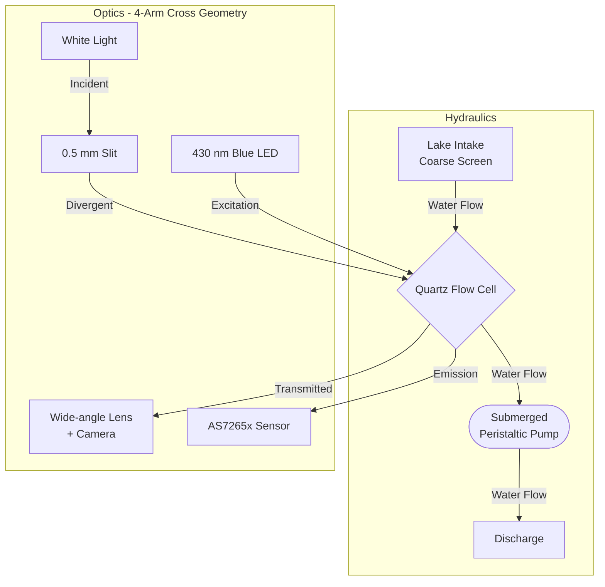

# Cruz Prototype

> **Autonomous Spectrophotometer and Fluorometer for Natural Water**

Cruz integrates the previously separated MonoSpectro and fluorometer instruments into a single autonomous apparatus. By sharing a central sample chamber in a 4-arm cross geometry, it performs both transmission and fluorescence measurements in-situ.

## 🎯 Engineering Scope
This repository contains exclusively the **engineering, design, fabrication, firmware, and validation** of the Cruz prototype.
*The scientific paper and related publications fall outside the scope of this repository.*

## 📊 Current Status
- 🟢 **Functional specification approved**
- 🟡 **Optical design in progress**
- ⚪ **Validation pending**

## 🔬 System Architecture

The system physically separates the wet circuit from the electronics. The optics follow a 4-arm cross geometry, enabling collinear excitation and detection for fluorescence, and direct transmission measurement on the perpendicular axis.

## 📐 Design Principles
- **Sensor Reusability:** Retain original detectors (monochrome camera for spectrophotometry, AS7265x for fluorescence) and sources.
- **Shared Geometry:** Use a single quartz flow cell to measure the same sampled volume for both modalities.
- **In-Situ Autonomy:** Designed to operate independently for days, handling water renewal and local data storage.
- **Printable Hydraulic Barrier:** The 3D-printed body is designed and tested to act as the primary hydraulic barrier, rather than just structural support.

## ⚙️ Current Specifications
| Parameter | Target Objective |
| :--- | :--- |
| **Medium** | Freshwater (lakes), no reagents during deployment |
| **Autonomy** | 72 hours without intervention |
| **Cadence** | 1 cycle every 15 minutes (288 cycles per 72 h) |
| **Service Depth** | Up to 1 m immersion |
| **Enclosure Protection** | IP68 design objective (internal watertightness test, not certified) |
| **Optical Range** | 420–780 nm (Transmission) |

## 📅 Schedule and Key Milestones (2026)
| Date | Milestone |
| :--- | :--- |
| Oct 5–6 | Functional specification closed |
| Oct 7–12 | Optics closed, integration verified |
| Oct 13–19 | Editable CAD, blueprints, and full sealing design |
| Oct 20–23 | Schematics, energy budget, and BOM |
| Oct 26–29 | Parts fabricated and inspected |
| **Oct 30** | **Watertightness test (no electronics) - Hard Deadline** |
| Nov 5–11 | Integrated firmware & autonomous acquisition |
| Nov 24 | Multi-hour field test in lake |
| **Dec 1** | **Delivery of prototype and verifiable evidence** |

## 📂 Repository Structure
- [`ESPECIFICACION.md`](ESPECIFICACION.md) - Functional specifications and fixed requirements.
- [`DECISIONES.md`](DECISIONES.md) - Engineering decisions log and status.
- [`docs/ANALISIS_ARQUITECTURA.md`](docs/ANALISIS_ARQUITECTURA.md) - Architecture analysis for detectors, optics, and operation.
- [`docs/DISENO_OPTICO.md`](docs/DISENO_OPTICO.md) - Detailed optical design and geometry.
- [`docs/PLAN_TRABAJO.md`](docs/PLAN_TRABAJO.md) - Detailed schedule, dependencies, and work plan.

## 📸 Documentation Workflow & Photographic Record
Traceability is mandatory. Calibration coefficients must be maintained in an editable file with a reproducible procedure. A complete **photographic record** of every real stage of assembly is required. Interfaces, hidden joints, and wiring must be photographed before being covered. Deviations and physical tests (such as the watertightness test) must be backed by verifiable photographic evidence.
