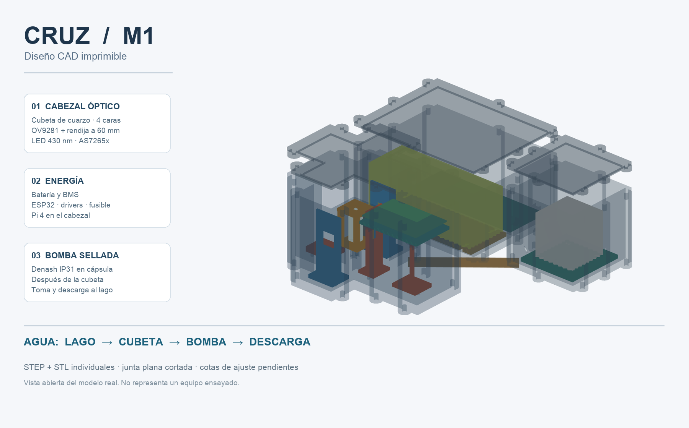

# CRUZ M1 — diseño mecánico paramétrico

**Estado: revisión dimensional y ensayos pendientes.** Este modelo contiene las piezas imprimibles, archivos STEP editables, STL individuales y una vista 3D de montaje. Es una base concreta para revisar y ajustar; todavía no acredita estanqueidad ni autonomía. No se ha impreso ni comprado nada al crear estos archivos.

## Vista del conjunto



El [modelo 3D interactivo](../docs/renders/CRUZ-M1-CAD-interactive.html) y los ensamblajes [abierto](m1_export/CRUZ_M1_open_assembly.glb) / [explosionado](m1_export/CRUZ_M1_exploded_assembly.glb) sirven para inspeccionar la disposición. Los [STL imprimibles en ZIP](m1_export/CRUZ_M1_print_parts.zip) y los STEP individuales están en [`m1_export/`](m1_export/); [`manifest.json`](m1_export/manifest.json) da tamaño, volumen y cantidad de cada pieza. Las fuentes son [`CRUZ_M1.py`](CRUZ_M1.py) y [`render_m1.py`](render_m1.py). Todas las cotas están en **mm**.

El cabezal en cruz mide **207 × 160 × 120** sin tapa; el alojamiento de energía, **190 × 150 × 90**; el de bomba, **105 × 105 × 100**. Se enlazan con cuatro pletinas impresas y tornillería M4 fuera de las cavidades secas. La planta completa aproximada es **350 × 345 mm**, sin bucles de tubo, anclaje ni guardacables. Ninguna pieza imprimible supera **220 × 220 mm** en planta.

## Función e interfaces

```text
                                      LED 430 nm
                                          ↓
Lámpara halógena 10 W  →  cubeta de flujo  →  rendija metálica 0,5 mm  →  red/lente/cámara OV9281
                                          ↓
                                      AS7265x (18 canales)

Lago → toma → pasamuros del cabezal → cubeta → pasamuros del cabezal
     → tubo exterior → pasamuros de cápsula → bomba peristáltica → pasamuros → descarga al lago
```

El eje espectral conserva **60 mm nominales entre la rendija y el plano de lente/cámara que se confirme sobre el MonoSpectro real**, y el soporte de cámara fija **36°** en planta. Las cuatro aberturas de las monturas se centran en el eje **z = 60 mm** del modelo. La rendija de 0,5 mm **es la pieza metálica existente**: `H05` solo la sujeta. Bases ranuradas se atornillan en agujeros ciegos del fondo; las posiciones finales del LED, AS7265x, lámpara y cámara se ajustan con calzas después de medir el conjunto físico. La transmisión va primero; la fluorescencia, después. La celda queda siempre llena entre ciclos.

La variante enlazada por Alex es la [NEXACULE de cuatro caras, 3,5 ml y 10 mm de camino óptico](https://www.nexacule.com/collections/flow-cuvettes/products/quartz-flow-cuvette-brownloo-quartz-flow-cells-two-ends-open-nexacule?variant=46090230005978), ID **46090230005978**. Una foto de la galería acota **40 × 12,5 × 12,5 mm** para el cuerpo y **60 mm** de longitud total de un ejemplar de la serie; el modelo usa esas cotas *provisionalmente* hasta medir la variante de cuatro caras entregada. Los diámetros exteriores de los dos tubos de vidrio y sus tolerancias no figuran en la ficha: no se debe forzar una manguera ni una abrazadera sobre ellos.

La [Denash B0FRB83924 indicada por Alex](https://www.amazon.com.be/-/en/Denash/dp/B0FRB83924) se anuncia como bomba de motor paso a paso 42, **6–24 V**, **0–140 ml/min**, cabeza **57 × 57 × 23 mm**, altura total cercana a **60 mm**, separación de montaje **47 mm**, tubos **2×4 o 3×5 mm** y **protección IP31**. Esos datos de vendedor no sustituyen una medición ni una prueba de caudal. **IP31 no permite sumergirla desnuda**: `P01` es una cápsula seca específica, con dos racores estáticos para el agua y un pasamuros de cable. La bomba sigue aguas abajo de la muestra.

## Piezas del M1

| Código | Piezas impresas | Función |
|---|---:|---|
| H01–H02 | 1 + 1 | Cuerpo cruciforme y tapa del cabezal óptico |
| H03–H04 | 1 + 1 | Soporte abierto y abrazadera de cubeta, sin tapar las cuatro caras |
| H05–H06 | 1 + 1 | Portarrendija metálica y placa orientada 36° para cámara |
| H07–H08 | 1 + 1 | Soportes ajustables de LED y AS7265x |
| H10 | 1 | Base para **soporte metálico** de portalámparas cerámico; la lámpara no toca plástico |
| H11 | 1 | Bandeja elevada para Raspberry Pi sobre el brazo de la cámara; cinta CSI enteramente dentro del cabezal |
| E01–E04 | 1 cada una | Caja de energía, tapa, bandeja de batería y bandeja Pi/ESP32/protecciones |
| P01–P03 | 1 cada una | Cápsula de bomba, tapa y placa ranurada de sujeción |
| M01–M02 | 2 de cada | Pletinas de unión externas entre los tres módulos |

Los archivos `*_gasket_PATTERN_ONLY` son **patrones para cortar junta plana de silicona de 2 mm**, no piezas de plástico a imprimir. Se sitúan en una banda continua del borde, por dentro de los tornillos. Las tapas tienen una lengüeta interior de centrado. Los taladros ciegos en las torres exteriores prevén insertos roscados M4; el diámetro piloto de 5,5 mm es provisional según inserto/material. Los soportes ópticos y la cubeta se fijan en taladros ciegos M3 del fondo de **8 mm**. Ningún tornillo atraviesa el volumen seco.

## Batería, electrónica y seguridad

`E03` reserva **160 × 60 × 62 mm** de volumen conceptual para la batería y dos pasos de cincha; **no se ha elegido pack**. `E04` aloja el ESP32, protecciones/BMS, fusible y drivers mediante cinchas. La **Pi 4 se ubica en H11**, sobre el brazo de cámara, para mantener la cinta CSI en una sola cavidad seca; alimentación y enlace serie cruzan un pasamuros de cable convencional hacia `E01`. La pared interior de `E01` separa físicamente bandejas, pero **no es una barrera de fuego ni una cámara estanca independiente**. El cálculo previo de unos 163 Wh es solo ilustrativo; si la Pi queda encendida, el consumo puede exigir un pack mayor. La capacidad, BMS, química, fusible, cable y drivers se cierran con consumo real en X1.4.

La lámpara halógena conserva un **portalámparas cerámico y una escuadra/disipador metálico**. `H10` es solo la base de fijación, lejos del bulbo. La temperatura de plástico, cubeta, electrónica y agua debe medirse a máxima duración de encendido antes de fabricar la envolvente definitiva. Se prevé sensor de humedad/fuga en el cabezal y cápsula de bomba; sus soportes y conectores exactos dependen de la placa elegida. Una fuga interna obliga a parar bomba y fuentes y guardar un registro seguro.

## Cierre, montaje y ensayo

1. Imprimir primero **probetas de material y encaje**, después de confirmar la óptica y medir cubeta, tubos, bomba y placas. No usar directamente los STL como orden de fabricación.
2. Imprimir los tres cuerpos con el **fondo sobre la cama y boca hacia arriba**. Imprimir tapas con la cara externa sobre la cama y la lengüeta hacia arriba. Elegir material y proceso tras ensayo térmico/químico; las paredes impresas necesitan acabado y prueba de permeación. La ficha de la impresora concreta fijará perímetros, altura de capa y soportes.
3. Cortar juntas planas a partir de los patrones; escoger silicona compatible con agua y espesor real. Ajustar presión de compresión y apriete de tornillos con una probeta. Seleccionar **racores de mamparo y pasamuros comerciales con junta propia**. Los diámetros `FLUID_BORE=8` y `CABLE_BORE=10` del código son lugares reservados: modificarlos según la ficha del componente elegido.
4. Fijar la cubeta con apoyos blandos compatibles con cuarzo; conectar tubo flexible sin esfuerzo lateral. Ruta interna: conexión inferior hacia pasamuros inferior de toma; conexión superior por el espacio sobre la cubeta y una esquina libre hasta el segundo pasamuros inferior. Verificar radio mínimo y que el tubo no cruza el haz.
5. Montar bomba dentro de `P01`; conectar **salida de cubeta → entrada de bomba → salida al lago**. Ninguna soldadura ni motor debe quedar en contacto con agua. Mantener la batería fuera de esta cápsula. Etiquetar toma y descarga.
6. Cerrar con **lastre y sin electrónica**. Ensayar cada caja y el conjunto, con todos los racores/cables/tubos previstos, el **30 de octubre de 2026** a la profundidad objetivo de 1 m. Fotografiar junta, pasamuros, interior seco y resultado. Si falla, corregir y repetir antes del montaje eléctrico. La continuidad de impresión no es prueba de IP.

Los orificios exteriores de M4 permiten sujetar una placa de lastre y un cabo **mediante un bastidor metálico**, dimensionados después de pesar el conjunto y medir flotación. No confiar el izado del instrumento solo a una oreja impresa.

## Cotas que bloquean fabricación

| Medir/verificar en pieza real | Por qué importa |
|---|---|
| Cubeta: largo/caras, posición de volumen útil, diámetro y fragilidad de boquillas | Abrazadera, altura de ejes y unión a tubo |
| Bomba: número y posición real de taladros, envolvente con conectores, giro de cabeza y radio del tubo | Placa `P03`, cápsula `P01`, ruta interna y driver |
| Cámara OV9281 con lente/red: distancia de referencia real a rendija, volumen al girar 36°, cable CSI | Soporte `H06`, bandeja elevada `H11`, pared del brazo y enfoque |
| LED, AS7265x, halógena y portalámparas: centros ópticos, patrón de tornillos y calor | Adaptadores de `H07`, `H08` y `H10` |
| Racores de mamparo, prensaestopas, junta plana, insertos M4 y tubo | Taladros, compresión, permeación y apriete |
| Batería/BMS/driver escogidos después del balance de energía | Volumen `E01`, seguridad, autonomía de 72 h |

El modelo se regenera con `python cad/CRUZ_M1.py`. Para las imágenes, instalar opcionalmente `trimesh plotly kaleido` y ejecutar `python cad/render_m1.py`. La dependencia de geometría es [`build123d`](https://build123d.readthedocs.io/en/latest/). STEP es el formato de intercambio editable; el código Python conserva las restricciones y parámetros de diseño.
