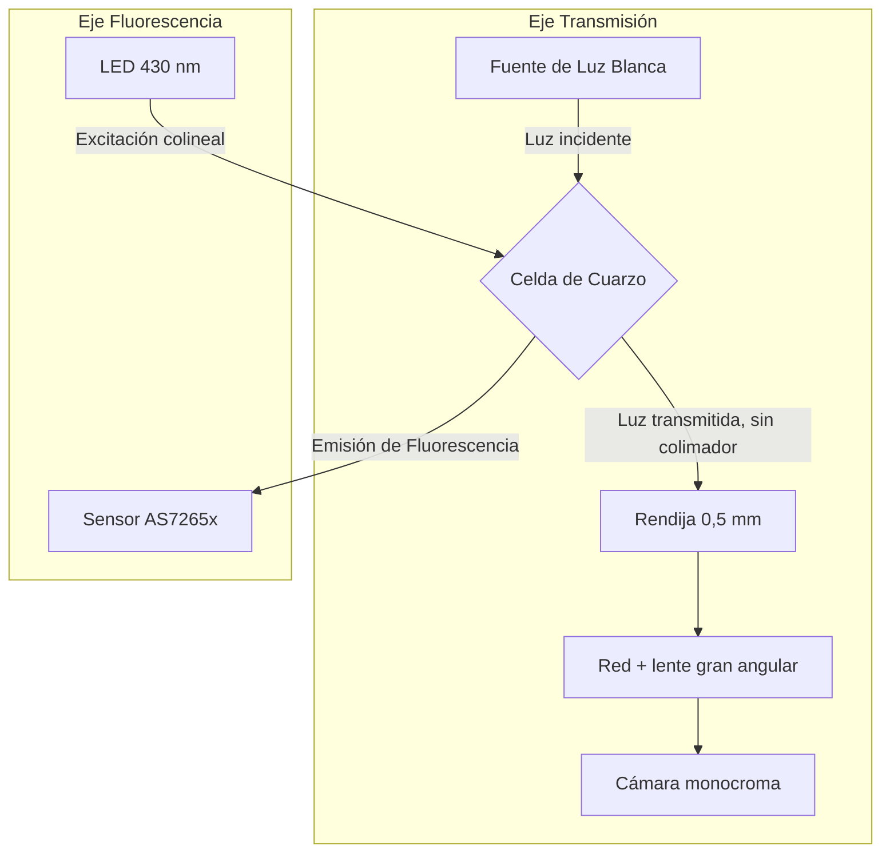

# Diseño Óptico Detallado: Cruz

Este documento técnico define la geometría y los componentes ópticos del prototipo Cruz. El diseño está en curso y sirve como especificación base para el diseño mecánico y electrónico.

## 1. Parámetros Confirmados
*   **Rendija de Transmisión:** 0,5 mm de ancho, después de la celda en el camino óptico. Alex confirmó una separación nominal de 60 mm respecto a la cámara; la figura del MonoSpectro acota 60 mm hasta la red/lente unida a ella. Medir las superficies de referencia antes de trasladar esa cota al CAD.
*   **Rango Espectral de Transmisión:** 420–780 nm.
*   **Lente:** Gran angular (la utilizada y validada físicamente en el montaje de MonoSpectro).
*   **Celda de Muestra:** Celda de flujo de cuarzo, comprada y compartida entre ambos caminos ópticos.
*   **Fluorescencia (Excitación):** LED azul de 430 nm.
*   **Fluorescencia (Detección):** Sensor AS7265x de 18 canales, usando el canal cercano a 645 nm como señal principal para clorofila. Se registrarán los 18 canales.
*   **Filtros Ópticos:** Sin filtro de emisión (la señal en 435 nm es excitación pura, el resto será procesado, confiando en la selectividad del sensor de 18 canales).
*   **Geometría:** 4 brazos radiales en configuración de cruz. La transmisión y la recepción de cámara en un eje, la excitación fluorescente (LED 430 nm) y detección AS7265x colineales en el otro eje perpendicular a la celda.
*   **Secuencia Óptica:** Primero medición de transmisión, luego fluorescencia.
*   **Hidráulica:** Toma -> Celda de cuarzo (entrada por una cara, salida por otra) -> Bomba peristáltica sumergida -> Descarga.

## 2. Geometría Propuesta

La distancia nominal de 60 mm pertenece al conjunto rendija–cámara heredado; el punto exacto desde el cual medirla sigue pendiente de verificación física.

## 3. Interfaces y Dimensiones Pendientes (TBD)
*   **Distancias Exactas AS7265x:** Distancia desde la ventana de cuarzo hasta la superficie del sensor AS7265x (TBD).
*   **Distancias Exactas LED:** Distancia desde el LED de 430 nm hasta la ventana (TBD).
*   **Acoplamiento Hidráulico:** Dimensiones precisas de los racores de entrada y salida de la celda de cuarzo (TBD).
*   **Posicionamiento de la Rendija:** Tolerancias de paralelismo de la rendija respecto al sensor de imagen de la cámara.

## 4. Tolerancias Ajustables Necesarias
*   **Enfoque de la Cámara:** Mecanismo de ajuste para afinar la distancia de la lente a la celda (TBD).
*   **Alineación del Eje Principal:** Capacidad de alinear perpendicularmente el haz de transmisión a las caras de la celda.
*   **Ajuste de Altura AS7265x/LED:** Calzas o correderas para garantizar la altura central de la fuente de excitación y detección frente al volumen útil de la celda de cuarzo.

## 5. Protocolo de Pruebas (OPT-01 a OPT-07)
| ID Ensayo | Descripción | Criterio de Aceptación (Numérico o TBD) |
|---|---|---|
| OPT-01 | Eje espectral y resolución | ≥3 líneas conocidas; error de centro ≤2 nm, FWHM objetivo ≤10 nm |
| OPT-02 | Transmisión de blanco y patrones | CV de intensidad ≤2 % fuera del fondo |
| OPT-03 | Naturaleza de señal del fluorómetro | 435 no satura, 645 responde con muestra fluorescente |
| OPT-04 | Sensibilidad en agua natural | SNR ≥10 en el nivel mínimo, CV ≤5 % sobre cuantificación |
| OPT-05 | Validación de geometría colineal heredada en nueva celda | Fondo del blanco ≤10 % de la señal neta del nivel bajo |
| OPT-06 | Interferencia entre modalidades | Cambio ≤5 % en fluorescencia y ≤0,02 AU en transmisión |
| OPT-07 | Ventana, celda y materiales | Registrar transmisión a 430 nm/visible y autofluorescencia |

## 6. Condiciones de Aprobación
El diseño óptico se dará por cerrado y autorizará la fase de CAD final, compras e impresión únicamente si:
1.  Los valores TBD se completan basados en ensayos físicos documentados (con fotografía y hoja de cálculo) o en especificaciones técnicas concretas del fabricante.
2.  Las pruebas OPT-01 a OPT-07 se completan con resultados positivos.

## 7. Trazabilidad a Archivos Fuente

| Dato / Decisión | Archivo Fuente / Ruta Local |
|---|---|
| Geometría, Rendija y Filtros | `/Users/alex/Nube /repos/Cruz_prototipe/ESPECIFICACION.md` |
| Geometría 4 brazos | `/Users/alex/Nube /repos/Cruz_prototipe/DECISIONES.md` |
| AS7265x y cálculo de clorofila | `/Users/alex/Nube /repos/Fluorometer/README.md` |
| Firmware Fluorescencia (menciona LED 435 nm como antecedente; no cambia especificación Cruz de LED 430 nm) | `/Users/alex/Nube /repos/Fluorometer/Spectro18_V_Flu/Spectro18_V_Flu.ino` |
| Fotos y Ensamblaje Original | `/Users/alex/Nube /repos/MonoSpectro/docs/images/cad_assembly.png` |
| Paper/Detalles del sistema | `/Users/alex/Nube /nube/investigacion/doctorado/espectroscopia/j.sna.2021.112698.pdf` |
