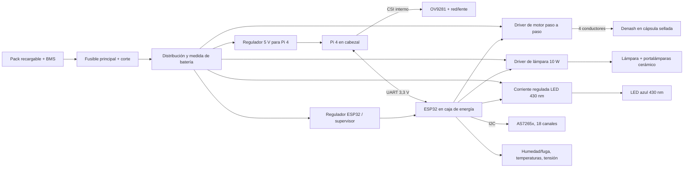

# Cruz M1 — arquitectura eléctrica preliminar

**30 de septiembre de 2026.** Ubicación física definida por el [CAD M1](../cad/README.md); esquemático con referencias y tensiones finales pendiente de medir los componentes el 20–23 de octubre. Este documento no autoriza energizar ni sumergir el conjunto.

**Cabezal H01:** Pi 4 sobre la cámara (`H11`) para que la cinta CSI permanezca en un compartimento seco; cámara OV9281, AS7265x, LED y lámpara. **Caja E01:** pack, BMS, fusible, ESP32 y drivers. **Cápsula P01:** motor y cabeza peristáltica, sin batería. Un pasamuros de cables une H01–E01 y otro E01–P01. El cable de cuatro fases de la bomba mantiene los colores indicados por el vendedor, pero se verificará la pareja de bobinas con ohmímetro antes de conectar un driver. La manguera fluye **cubeta → bomba → descarga**.

## Circuitos y verificaciones para el esquemático

| Bloque | Requisito de diseño | Dato que falta para cerrar |
|---|---|---|
| Pack/BMS/fusible | Cortocircuito y subtensión protegidos, apagado ordenado de Pi, balance real de 72 h a ciclos de 15 min | Química y pack físico, corriente pico, consumo medido por estado, fusible/umbral |
| Pi 4 + OV9281 | Alimentación estable incluso durante bomba y lámpara; CSI solo interno; registro local persistente | Consumo/arranque real, cable CSI y ocupación térmica en H11 |
| ESP32 + AS7265x | UART a nivel 3,3 V con Pi; I²C corto dentro del cabezal o interfaz adecuada entre cajas | Placa exacta y posición del AS7265x, longitud de cable/I²C y conectores |
| Halógena 10 W | Tensión nominal de la lámpara, limitación de corriente, apagado por sobretemperatura | Etiqueta, corriente de arranque, temperatura de portalámparas y cuerpo |
| LED 430 nm | Driver de corriente constante, oscuridad entre modalidades | Modelo, corriente, disipación, tiempo de estabilización |
| Bomba Denash | Paso a paso 6–24 V según anuncio; driver dimensionado por bobina, no por potencia publicitaria; retorno de fallos | Corriente/resistencia por fase, cable, par y caudal en agua/largo real de tubo |
| Estado instrumental | Humedad/fuga en H01 y P01, temperaturas en lámpara/batería, tensión y corriente de pack | Sensores físicos, calibración, umbrales de alarma |

El ESP32 supervisa fugas, temperatura y batería; ante fallo detiene bomba y fuentes y ordena a la Pi cerrar el archivo y apagarse. No se corta la Pi durante una escritura. La descarga de datos y el cambio de configuración se realizan tras recuperar el instrumento; el ciclo de campo funciona sin navegador.

El presupuesto de energía preliminar de [ANALISIS_ARQUITECTURA](../docs/ANALISIS_ARQUITECTURA.md) **no fija una batería**. `E03` solo contiene una envolvente de referencia de 160 × 60 × 62 mm. Si el pack calculado no cabe con BMS, aislamiento y cableado, se amplía `E01` en el código CAD antes de fabricar; no se reduce la reserva de energía para conservar la caja.

## Referencias ya identificadas

| Elemento | Referencia verificable | Estado |
|---|---|---|
| Cubeta | [NEXACULE variante 46090230005978](https://www.nexacule.com/collections/flow-cuvettes/products/quartz-flow-cuvette-brownloo-quartz-flow-cells-two-ends-open-nexacule?variant=46090230005978) | Indicada por Alex; 4 caras, 3,5 ml, 10 mm |
| Bomba | [Denash B0FRB83924](https://www.amazon.com.be/-/en/Denash/dp/B0FRB83924) | Indicada por Alex; IP31, necesita cápsula |
| Cámara | OV9281 y lente gran angular del MonoSpectro | Reutilizar tecnología; confirmar ejemplar disponible |
| Detector de fluorescencia | AS7265x del fluorómetro | 18 canales; confirmar placa y centro óptico |
| Computador y supervisor | Pi 4 y ESP32 | Arquitectura base; elegir placas efectivas |
| Batería, BMS, driver motor/LED/lámpara, racores, juntas | Por seleccionar con mediciones y cotizaciones | Sin referencia ni precio inventados |

La BOM definitiva deberá añadir fabricante, referencia, cantidad, proveedor, precio fechado e impuestos. Un enlace de venta no prueba que una pieza esté ya montada ni que su precio siga vigente.
