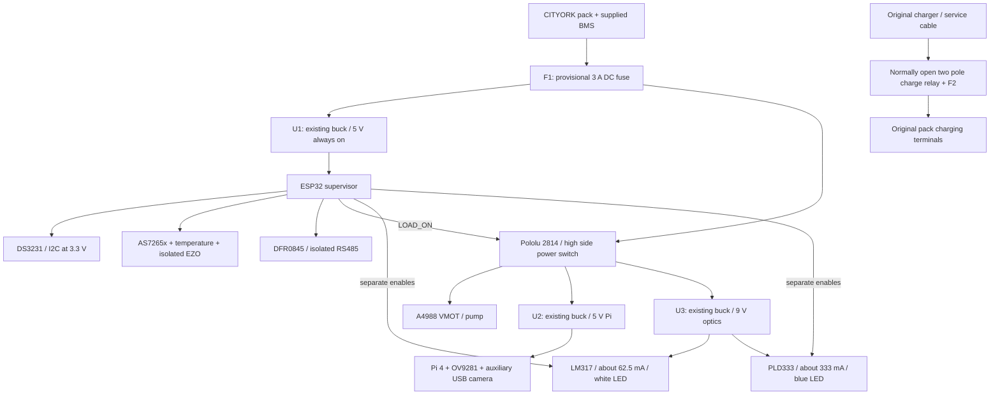

# Electronics V1 — technician review

> **Actualización 2026-11-02:** Alex eliminó el ESP32; la Raspberry Pi será el controlador principal. Este documento conserva la propuesta anterior como antecedente y sus conexiones, lista de piezas y supervisión con ESP32 ya no definen el diseño actual. El borrador nuevo y sus limitaciones están en [cross_v8_raspberry](cross_v8_raspberry/LEEME_PRIMERO.md). La lista de compra debe revisarse al cerrar el nuevo circuito.


**30 October 2026 · D52 · proposed circuit, not yet bench validated.** Alex has authorised electronics selection and a consolidated purchasing list. The earlier purchasing deferral D44 is superseded. No components have been ordered or electrically tested by this update.

## 1. Parts to reuse

| Part | Quantity allocated | Status |
|---|---:|---|
| A4988 red carrier, TinyTronics SKU 005700 | 1 | Available, confirmed by Alex; phase current and sense resistors must be checked |
| Adjustable 5 A buck, TinyTronics SKU 004606 | 3 | Available, confirmed by Alex; configure two to 5 V and one to 9 V |
| Raspberry Pi 4, ESP32 Dev Module, OV9281, AS7265x | Existing instrument parts | Reuse; confirm actual ESP32 board before assigning physical header positions |
| DS18B20 and Atlas K1.0 conductivity kit | Existing environmental sensors | Reuse; the K1 kit includes an isolated EZO carrier, so do not order a second one |

ARES_2025, sheet `Export`, rows 72 and 103 list 20 A4988 carriers and 20 buck converters. Row 81 also lists DS1307 RTC modules, but availability has not been confirmed. The proposed new DS3231 costs EUR 4 and provides temperature compensated timekeeping with a 3.3 V interface; a DS1307 is an alternative only after its supply, pull-ups and drift are checked.

**Correction, 2 November:** Alex subsequently confirmed the stock buck is DFR1015. The manufacturer of that candidate recommends below 24 V input, although it states a 30 V range limit. The 28 V criterion below was an internal provisional assumption and is not manufacturer approval; do not approve the candidate for the battery until the actual device and full voltage are known.

The [candidate buck](https://www.tinytronics.nl/en/power/voltage-converters/buck-(step-down)-converters/dc-dc-adjustable-step-down-buck-converter-5a-3.3v-5v-9v-12v) is specified for **7.5–30 V input**, not 36 V. Its 5 A marking is not evidence of stable 5 V delivery in a sealed enclosure. Verify the actual modules and temperature under the Pi/camera load. Alex later confirmed a 25.6 V charger and a single shared charge/discharge pair; see [V8 project and limitations](cross_v8_raspberry/LEEME_PRIMERO.md).

## 2. Power distribution



- A single **Pololu 2814 MP** switches the positive acquisition supply; keep its local slide switch OFF and control `ON` from the ESP32, with a 10 kΩ pull-down. All dry-side logic grounds stay connected. This device is specified for 4.5–32 V recommended operation and 4 A at the manufacturer's 55 °C comparison condition; the higher headline 8 A figure corresponds to a much hotter board. Check enclosure temperature and inrush. It does not provide a fuse or regulated output.
- U1 supplies the ESP32 through its **5 V/VIN** input, never through its 3V3 input. Derive logic 3.3 V from the actual board's regulator, after checking its capacity for all attached modules. AS7265x, RTC and controller-side EZO/RS485 signals must be compatible with 3.3 V; never pull an ESP32 GPIO to 5 V.
- U2 supplies the Pi through a short, correctly wired USB-C power lead from available workshop material. Set and verify 5.0 V at the Pi under load. Do not use a second USB power source or bypass the Pi supply protection through arbitrary GPIO wiring.
- U3 supplies only the LED circuits at 9 V. It is switched off with the acquisition branch. Keep motor returns out of optical/ADC return paths and connect branches at the distribution point. Twist motor coil pairs and keep them away from CSI, I2C and the cuvette.
- Use two 47 µF / 50 V electrolytics in parallel at VMOT (94 µF nominal), another pair at the switched distribution input, and another pair at U1 input. Add 330 µF / 25 V at each 5 V branch as starting values, plus local 100 nF decoupling at the motor logic, buffer, LM317 input and battery ADC. Check startup, overshoot and converter stability with these capacitors. They do not increase the converters' voltage ratings.
- F1 = 3 A and F2 = 2 A are **initial selections for bench review**, not measured coordination. Use DC-rated 32 V ATO fuses and covered holders. F2 assumes the actual charger current is sufficiently below 2 A after thermal derating; otherwise revise its rating with the actual charger, BMS and cable. Place each fuse close to the pack terminal it protects. Unplug the pack for maintenance; do not rely on the MOSFET switch as a physical service disconnect.

**Battery hold point:** measure the charger and fully charged pack, identify load/charge terminals and BMS ratings. For these 30 V bucks, use **28 V including measured excursions as a provisional acceptance ceiling**, leaving 2 V margin; this is a design criterion, not a manufacturer rating. A 29.4 V pack fails that criterion and requires a different converter selection. Do not assume that the advertised “24 V” means either 25.2 V or 29.4 V full charge. Start the circuit from a current-limited bench supply, with polarity verified. The kit charger remains the charger; no new BMS, charging algorithm or external-supply power sharing is designed into V1.

## 3. Optical sources

### White transmission source

Alex replaces the halogen with **Nichia NF2W757GT-F1 Optisolis, SKU 32724, 5000 K, CRI 98, star PCB**. Its specified test current is 65 mA and typical forward voltage is 2.9 V. Use this simple linear current source from the existing 9 V converter:

```text
+9V_OPT -> LM317 IN
LM317 OUT -> 10 ohm 1% -> 10 ohm 1% -> LM317 ADJ -> white LED anode
white LED cathode -> Q1 2N3904 collector
Q1 emitter -> GND
ESP WHITE_EN -> 330 ohm -> Q1 base; 47 kohm base-to-emitter
```

The resistor junction at ADJ also connects to the LED anode. **I ≈ 1.25 V / 20 Ω = 62.5 mA**, plus the regulator's small adjustment current; measure the actual current. The two 1/4 W resistors each dissipate about 0.039 W. At 9 V, the regulator dissipates roughly 0.3 W at nominal LED voltage: isolate its metal tab electrically from other parts and verify temperature. Check the pinout of the supplied LM317 and transistor rather than copying a package drawing from a different manufacturer. Power down before reconnecting the LED; do not add a charged output capacitor across it.

This costs less than a second power LED module and avoids applying the PLD333's default 333 mA to a 65 mA LED. A resistor alone from the battery is not the proposed LED driver. The operating current is a hardware setting; record its measured value in calibration.

**Procurement risk:** Alex confirms that this LED still has to be purchased. Ledrise currently shows a production order of **6–12 weeks**. No supplier with verified immediate stock of this exact 5000 K star-board assembly was found in this review. The same bare Rfc00 emitter is [listed separately as SKU 33712](https://www.ledrise.eu/leds/nichia-nfsw757g-v3-3030-package-white-mid-power-smt-led.html), with 3–6 weeks stated; it is not an immediate, assembled substitute. Keep Alex's chosen reference in the list, with procurement on hold until delivery is resolved. Listed EUR 1.85 excluding tax gives **EUR 2.24 with 21% VAT** for the budget.

### Blue fluorescence source

Alex's RS 0283199 is **ILH-XC01-S420-SC211-WIR200.**, on a 20 × 20 mm board. The ILS family datasheet gives a **420–430 nm peak bin**, 3–4 V forward voltage and radiometric specifications at 350 mA. The retailer labels it 430 nm; do not treat the exact peak as measured.

Use **LEOTRO PLD333 / AL8860, SKU 007287**, supplied from 9V_OPT, with the solder bridge **open**: nominal **333 mA**. This is below the 350 mA test current. Its default 0.3 Ω sense resistor is retained. `CTRL` goes to a dedicated 3.3 V ESP output through 1 kΩ, with a 10 kΩ pull-down. Verify that the assembled pull-down holds CTRL below its off threshold at reset; add a stronger pull-down if the measured board requires it, while respecting ESP output drive. Do not close the bridge to 667 mA. Neither LED terminal is a general-purpose ground terminal: connect only to the driver's labelled LED outputs.

Mount the LED boards to an aluminium heat spreader with suitable electrical insulation and thermal contact; fabricate the mount using fablab stock. A printed plastic bracket alone is not a heat sink. Verify the blue board's Tc remains below its 70 °C limit under the actual pulses and enclosure conditions.

Keep transmission first, then blue excitation, with the pump stopped. Use steady LED enable during each exposure, rather than uncharacterised PWM. Start with a configurable 100 ms dark interval after white-off; validate it experimentally, including the Optisolis phosphor afterglow. Re-measure blank, exposure, wavelength response and noise at 700–780 nm after replacing the halogen. CRI 98 does not establish a flat spectrum or the required signal-to-noise ratio.

Only **white and blue** have specified purchasing references. The earlier “five LEDs” was an energy assumption for the excitation set; reserve space/control expansion for the other wavelengths, without purchasing unselected emitters or assuming their current. This update does not reduce the requested future measurement scope or recalculate autonomy.

## 4. Pump and Pi supervision

**A4988 reuse is conditional on the actual motor and carrier.** Four wires identify a bipolar connection, not the phase current. Find the two coil pairs with an ohmmeter. The 20 W / 24 V figures do not determine the current limit per phase.

- A4988 VDD = 3.3 V, VMOT = switched pack rail. `/ENABLE` has a 10 kΩ pull-up to 3.3 V, STEP and DIR have 10 kΩ pull-downs. Keep RESET/SLEEP in their documented active states; set the microstep inputs deliberately and record the chosen mode.
- Read the carrier sense resistor markings. For an actual A4988, **I_limit = VREF / (8 × Rsense)**. Do not copy the VREF of a different carrier. Record Rsense, VREF and phase limit. Begin with conservative limited-current bench tests; obtain the motor phase rating before approving the final setting. The carrier's quoted peak 2 A is not a sealed-box continuous rating.
- Fit the VMOT electrolytics close to the carrier. Never connect/disconnect the motor with the driver powered. Check winding/driver temperature, missed steps, backpressure and delivered volume with the actual 3 × 5 mm tube. Driver current limiting is not proof of flow.
- The ESP32 owns the cycle. It starts the acquisition supply, allows Pi startup and pump renewal, disables the pump, waits for optical settling, then measures transmission and fluorescence. Boot and pumping may overlap; verify total startup current against the BMS. No optical measurement during pump operation.
- After files are flushed, request Linux shutdown. Use a dedicated **Pi GPIO power-off indication generated at the final kernel shutdown stage**; a serial “command received” message is insufficient. Cut the acquisition rail only after that indication and a tested settling delay. If shutdown times out, record a fault and follow an explicitly configured recovery policy; never label an emergency cut as a clean shutdown.
- ESP-to-Pi UART passes through **SN74LVC245AN**, powered by the **Pi's switched 3.3 V**, using A-to-B direction. Its Ioff feature prevents the always-on controller from feeding the unpowered Pi. `/OE` is pulled up to the Pi's 3.3 V and enabled only when ready, using a GPIO or a verified fixed wiring for the first bench assembly. Tie unused inputs to a defined level. Pi-to-ESP UART may be direct at 3.3 V, with ESP input pull-ups disabled while Pi is off. Check all other links for back-power paths, including external USB.

## 5. Time, sensors and service port

- **Open-Smart DS3231 SKU 005386**: VCC and I2C pull-ups at 3.3 V. Read UTC on each wake. Use the ESP timer to wake and reschedule against the RTC; an exposed RTC interrupt pin is not required by this plan. Confirm backup cell and oscillator status on receipt. Keep the clock running when the Pi is off.
- AS7265x keeps all 18 channels. Configure the isolated Atlas EZO carrier for the selected digital interface; propose I2C, and verify addresses/no collisions on the actual boards. Supply temperature compensation from the water DS18B20. The DS3231 temperature reading is not a calibrated replacement for the water thermometer.
- The proposed leak board is TinyTronics SKU 001093, powered at 3.3 V and read on an ADC1 pin. Install at the lowest dry-side collection point. It is a **wet/dry alarm**, not a calibrated water-level or relative-humidity sensor. Wet it during bench verification and latch a fault; leave the acquisition supply and charging relay off after detection. Humidity measurement remains an unimplemented auxiliary requirement and is not claimed by this board.
- Battery voltage: 100 kΩ / 10 kΩ divider, 100 nF at the ADC node, ESP ADC1. At 30 V the nominal node is 2.73 V. Calibrate with a meter and store gain/offset and thresholds in configuration. It estimates terminal voltage, not state of charge or coulombs. Battery cutoff thresholds remain unset until chemistry/full-charge voltage are known.
- **DFRobot DFR0845**, powered at 3.3 V, connects ESP UART to the isolated RS485 side. Route A, B and **bus-side reference** to the EN3. Do not bond that isolated reference to battery negative. Leave its auxiliary 12 V bus output unused and insulated. Set termination only at the two ends of the actual link and verify the module's existing termination/bias before adding resistors.
- PC side: **Waveshare USB TO RS485 (B), CH343G, model 22456**. Wire its labelled A/B/reference to the matching service signals; check the delivered terminal labels. It is not the charger. Use Modbus RTU for the proposed measurement/status map; raw file export needs a separate, documented block-transfer command with integrity checking and resume. Keep original spectra and images on the Pi.

### Charge connection and future buoy

Use the original charger through the two reserved charge contacts, **via the normally open contacts of a two-pole G2RL-2 DC5 relay**. Both charge conductors return only to the pack's documented charge terminals, independently of the load return. Its 5 V coil is switched by Q2 2N3904, emitter to GND, base through 220 Ω with 47 kΩ base-emitter pull-down, and 1N4007 flyback diode, cathode to +5V_AON. Verify the actual contact DC rating against charger voltage/current, not the headline AC switching voltage.

Propose using the eighth contact for **service-cable detection**, replacing the unused reserve function. A jumper in the dry service harness closes a limited-current loop to the external-power return contact (connected to dry GND). Suggested input: +5V_AON → 680 Ω → LTV-817 LED → pilot contact; antiparallel 1N4007 across the optocoupler LED. Collector to ESP input with 10 kΩ pull-up to 3.3 V; emitter to dry GND. No pack voltage on this loop. Charge relay permission requires cable detected, explicit charge mode and no leak fault; reset, cable removal or watchdog loss must release it. Demonstrate release on unplugging; software alone is not a certified connector interlock.

**No numbered EN3 pinout is released yet.** Verify cavity numbering from the mating-face and solder-side drawings and the actual charge arrangement before soldering either end. Use the full eight-function net list: CHARGE+/− (2), future EXT+/− (2), A/B/BUS_REF (3), PILOT (1). EXT+ stays disconnected/insulated in V1; EXT− is the pilot reference. The pilot does not bridge charge negative or isolated BUS_REF. The future buoy supply will require its own compatible source-selection circuit; it must not be connected directly in parallel with the pack.

The relay is an **isolation switch, not a charger**. Charge in dry service conditions with the matched charger, acquisition off, following pack instructions; no sealed charging temperature/gas behaviour has been validated. If the BMS has cut off and the supervisor cannot energise the relay, recover through the original charge connection with the housing open. Do not silently bypass the BMS to solve this prototype limitation.

## 6. Assembly and remaining release checks

Use the consolidated shopping workbook for missing parts only. Reuse mounting board, insulated internal wiring, USB/CSI leads and terminal hardware previously removed from purchasing by Alex; check these supplies physically before assembly. Fit the LED aluminium support and the A4988 thermal mounting using workshop material. No custom PCB, drilling or solder-side pin layout is represented by this functional drawing.

1. **Pack/charger:** actual full-charge voltage, terminal arrangement, continuous/pulse and charging currents; buck voltage margin accepted.
2. **Motor:** real phase rating, coil pairs, Rsense/VREF, torque/flow and thermal test. Reuse A4988 only if it passes.
3. **Rails and states:** current-limited bench supply first; check 5 V under both cameras, all actuators off at reset, clean Pi shutdown, no GPIO/USB back-power, charge relay open with cable absent and on faults.
4. **Optics/sensors:** measured LED currents/temperatures, dark readings, fresh transmission blank and 18-channel fluorescence, conductivity isolation/compensation, leak trip and configured battery alarms.

These are unresolved commissioning checks, not results. The **30 October watertightness test still uses ballast and no electronics**. No successful sealing test is recorded here. Do not install electronics in the enclosure before that test passes.

## Sources

- [Nichia exact LED specification](https://led-ld.nichia.co.jp/api/data/spec/led/NF2W757GT-F1-E%285056%29Rfa00%20Rfc00.pdf), [selected star PCB](https://www.ledrise.eu/nichia-nf2w757gt-f1-optisolis-smd-led-with-star-pcb-23lm-5000-kelvin-cri-98-sku-32724.html).
- [ILS PowerStar family datasheet, page 3](https://docs.rs-online.com/3301/A700000012614806.pdf), [selected RS item](https://benl.rs-online.com/web/p/uv-leds/0283199).
- [TI LM317 current-regulator application](https://www.ti.com/lit/ds/symlink/lm317.pdf); verify the purchased supplier's pinout/tolerances.
- [AL8860 manufacturer datasheet](https://www.tinytronics.nl/product_files/007287_AL8860_datasheet.pdf), [LEOTRO module design](https://github.com/Leotro-Engineering/Power-LED-Driver).
- [Pololu 2814 operating/thermal/control limits](https://www.pololu.com/product/2814), [A4988 current-limit procedure](https://www.pololu.com/product/1182). The red stock carriers are not asserted to be Pololu boards.
- [TI SN74LVC245A, partial power down](https://www.ti.com/lit/ds/symlink/sn74lvc245a.pdf), [DFRobot isolated RS485 documentation](https://wiki.dfrobot.com/dfr0845/), [Atlas kit contents](https://sensorsandprobes.com/products/conductivity-k-1-0-kit).

Supplier links, dated unit prices and quantities are in [the shopping list](../LISTA_COMPRA.md). Prices are a budget, excluding shipping; they are not purchase confirmations.
